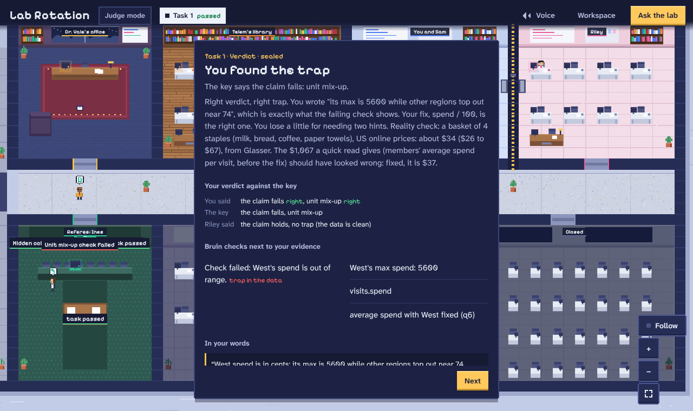

<div align="center">


# Lab Rotation

**Your first week as a data analyst.** A panel of AI scientists hands you a dataset that may hide a trap, watches how you work, and grades you against a real answer key.

Multiplayer AI Hackathon · Finch, AWS Builder Loft · Track 3 "Grow with Agents"

<br>


<sub>Judge mode on the recorded mock session, sped up.</sub>

</div>

## How it works

| | |
|---|---|
| **Brief** | Dr. Vale picks a task with the learner model and walks the claim to your desk: *"Loyalty members spend more than twice as much per visit."* |
| **Dig** | Browse the tables, profile columns or write SQL. Click any row, column or cell to cite it as evidence. |
| **Hint** | Stuck? Sam asks the panel, then drops by with one question, never the answer. Riley, a rival AI intern, works the same task blind next door. |
| **Answer** | Say whether the claim holds, fails or can't be told, name the trap and cite the rows that prove it. |
| **Verdict** | The panel confers in private, Ines runs real Bruin data-quality checks and seals the verdict against the answer key. |
| **Next** | Your mastery of that trap moves, Telem brings a real case of the same mistake, and the next task aims at what you haven't mastered yet. |

Every move on the pixel lab floor comes with the reason behind it, so you can see why the lab did what it did.



## What you can do

- **Judge mode.** One task on a 4-minute clock, then a three-step debrief: the verdict, how the panel decided (their private transcript), and your mastery with a real case of the same mistake.
- **Your rotation.** The full session: task after task in the Workspace (table browser, SQL, column profiles, chart builder, evidence picker, answer form), ending on your skill for each trap.
- **Watch the demo.** A recorded rotation told as a nine-scene story, one caption at a time.
- **Ask the lab.** Ask anyone on the panel a question. Each answers only from what they can see and says what they used.

## The cast

| Who | Job | What they do |
|---|---|---|
| **Dr. Vale** | Lab head | Picks each task with the learner model, brings the brief and sits on the panel. |
| **Telem** | Librarian | Looks up background on the claim, watches the news for the case of the day, brings a real case after the verdict. |
| **Sam** | Methods reviewer | Watches how you work and drops by with a hint: always a question, never the answer. |
| **Ines** | Examiner | Runs the Bruin checks, grades your verdict, trap and evidence against the key, seals the record and rules on appeals. |
| **Riley** | AI intern | Your rival: works the same task from the same tables without ever seeing yours. |
| **You** | Rotation student | The workspace is yours; the panel only sees what you do there. |

## Run it locally

You need Python with [uv](https://docs.astral.sh/uv/) and Node.

```bash
git clone https://github.com/NivedN08/lab-rotation
cd lab-rotation
LAB_MOCK=1 uv run python web/server.py --port 8790   # mock mode: replays a recorded session, no keys
cd web && npm install && npm run dev                  # http://localhost:5173/?mock=0
```

Plain **http://localhost:5173** runs on the front end's built-in sample data with no server at all (a "Sample data" chip says so). `LAB_MOCK_SPEED=3` plays the mock session faster. The hosted replay is built with `VITE_STATIC=1` and opens on "Watch the demo" only.

## How we used each sponsor

Every sponsor does a real job in the session, not a logo slot. Each one has its own client in [`lab/sponsors/`](lab/sponsors/), every call is logged as a `sponsor.call` event with its cost and a trace link, and the **sponsor strip** above the timeline counts the calls live while you play. If a service is down, a recorded fallback answers in the same shape, so the demo never breaks.

### BAND: the panel's private room

The examiner panel really does confer in private, and BAND is where that happens.

- **Dr. Vale, Ines and Sam are each their own BAND agent**, with their own key and agent id, and post into a shared **Panel room** as themselves ([`band.py`](lab/sponsors/band.py)).
- Before Sam gives you a hint, he asks the panel in the room first. After you answer, the three of them discuss your verdict, trap and evidence there before Ines rules.
- Each message @mentions the agent it's for, because BAND only delivers to the agents mentioned. Telem and Riley have no BAND identity, so Vale relays their lines into the room.
- The room stays hidden while you work. After the verdict, the debrief opens the full transcript ("How the panel decided"), so you see exactly how they reached it.
- Fallback: a local room with the same message shape (`local: true`).

### Telem AI: the librarian's research and the case of the day

Telem, the lab's librarian, is powered by Telem AI search and fetch ([`telem.py`](lab/sponsors/telem.py)).

- **During the brief**, she looks up real background on the claim (for example, how retailers measure loyalty spend per visit), so you know what to watch for.
- **Ask the lab:** when you ask Telem a question, she answers with a live search and shows her links and the trace.
- **After the verdict**, she brings a **real-world case of the same mistake** (a chain that restated a region's sales because its export was in cents), with the source on a card.
- **Case of the day:** a daily Telem monitor watches the news for data mistakes. When it catches one, Dr. Vale can pick your next task to match it.
- Every call carries a trace link that opens it in Telem's traffic view. Fetched pages go to the agents as quoted, untrusted data, never as instructions.
- Fallback: cached results (`recorded/telem_search.json`).

### Bruin: the checks behind every verdict

Ines never grades on vibes. Each verdict rests on real data-quality checks run with Bruin over DuckDB ([`lab/tasks/bruin_run.py`](lab/tasks/bruin_run.py), [`lab/tasks/checks.py`](lab/tasks/checks.py), [`bruin/`](bruin/)).

- There is **one check per trap**: duplicated rows, unit mix-ups, a misleading data dictionary, a batch confounder, and a hidden column in a second table.
- For each task, the task's public tables are staged as Bruin assets and `bruin run --tag task` runs the custom checks. The checks only read what a careful analyst could see.
- On the floor, Ines walks to the referee bench and the results appear one by one ("Check failed: West's spend is out of range").
- The verdict card shows the **failing Bruin check next to your evidence**, so you can see whether you cited the rows that prove it.

### Runware: voices, portraits and the rival intern

Runware gives the cast a voice and a face, and runs Riley, the rival, on a different model from the panel ([`runware.py`](lab/sponsors/runware.py)).

- **Voices:** every spoken line from Vale, Telem, Sam, Ines and Riley is read aloud with Inworld TTS-2 through Runware, with one voice per character (about $0.004 a line). Mute it with the Voice button.
- **Portraits:** each character's portrait is generated with FLUX schnell on Runware ($0.001 each).
- **Riley runs on GPT-5.4 mini, served through Runware.** That makes the rival a genuinely different model. It works the same task from the same tables without seeing yours, and its answer meets yours at the hatch. In the demo it falls for the trap ("members came out 2.4 times higher, so it holds").
- Fallbacks: Riley falls back to a sandboxed `claude -p`, portraits to the files already on disk, and voices to silence.

### Glasser: real retail numbers

Glasser keeps the made-up stores honest with real-world numbers ([`glasser.py`](lab/sponsors/glasser.py)).

- **Task generator:** it pulls a real retailer's disclosed KPIs, such as store count, traffic growth and comparable-store sales growth, from `financialdatasets` ($0.02), plus Google Shopping prices from `serper` ($0.002). The task bank builds each synthetic retail dataset at a realistic scale and price level from them.
- **Hints and reality checks:** Sam prices a basket of 4 staples live ("about $34, from Glasser"), so you can see that a $1,067 average spend per visit is impossible. The verdict quotes the same check.
- Every call shows its `charge_usd` and a link to the run on app.glasser.ai. Each session is capped by a budget (`GLASSER_BUDGET_USD`, default $0.25).
- Fallback: a recorded retail set (`recorded/glasser_retail.json`).

### Teamily: the practice summary

After a rotation, [`teamily.py`](lab/sponsors/teamily.py) writes a practice summary: the tasks you did, your score on each and how your mastery of each trap moved. Teamily's API wasn't public during the hackathon, so the summary is saved locally and posted to `TEAMILY_POST_URL` when that's set.

Routes and events are documented in [`contract/api.md`](contract/api.md) and [`contract/events.md`](contract/events.md).

## Built with

Claude (every agent runs as a headless, sandboxed `claude -p` that never sees a key) · BAND · Telem AI · Bruin · DuckDB · Runware · Glasser · Python · Vite · React

## Team

[Nived](https://github.com/NivedN08) and [Nick Dev](https://github.com/nick-devvv)

<sub>Built on our earlier pixel-lab project, summit-lab, with the moderators' approval. The learner's seat, workspace, panel, judge mode, demo story and backend connection were built today.</sub>
