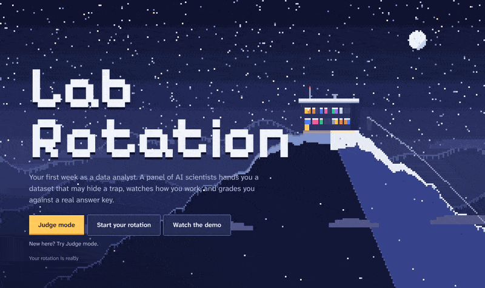

<div align="center">


# Lab Rotation

**Your first week as a data analyst.** A panel of AI scientists hands you a dataset that may hide a trap, watches how you work, and grades you against a real answer key.

Multiplayer AI Hackathon · Finch, AWS Builder Loft · Track 3 "Grow with Agents"

<br>



<sub>Judge mode on the recorded mock session, sped up.</sub>

</div>

## How it works

| | |
|---|---|
| **Brief** | Dr. Vale picks a task with the learner model and walks the claim to your desk: *"Loyalty members spend more than twice as much per visit."* |
| **Dig** | Browse the tables, profile columns or write SQL. Click any row, column or cell to cite it as evidence. |
| **Hint** | Stuck? Sam asks the panel, then drops by with one question, never the answer. Riley, a rival AI intern, works the same task blind next door. |
| **Answer** | Say whether the claim holds, fails or can't be told, name the trap and cite the rows that prove it. |
| **Verdict** | The panel confers in private, Ines runs real Bruin data-quality checks and seals the verdict against the answer key. |
| **Next** | Your mastery of that trap moves, Telem brings a real case of the same mistake, and the next task aims at what you haven't mastered yet. |

Every move on the pixel lab floor comes with the reason behind it, so you can see why the lab did what it did.


## What you can do

- **Judge mode.** One task on a 4-minute clock, then a three-step debrief: the verdict, how the panel decided (their private transcript), and your mastery with a real case of the same mistake.
- **Your rotation.** The full session: task after task in the Workspace (table browser, SQL, column profiles, chart builder, evidence picker, answer form), ending on your skill for each trap.
- **Watch the demo.** A recorded rotation told as a nine-scene story, one caption at a time.
- **Ask the lab.** Ask anyone on the panel a question. Each answers only from what they can see and says what they used.

## The cast

| Who | Job | What they do |
|---|---|---|
| **Dr. Vale** | Lab head | Picks each task with the learner model, brings the brief and sits on the panel. |
| **Telem** | Librarian | Looks up background on the claim, watches the news for the case of the day, brings a real case after the verdict. |
| **Sam** | Methods reviewer | Watches how you work and drops by with a hint: always a question, never the answer. |
| **Ines** | Examiner | Runs the Bruin checks, grades your verdict, trap and evidence against the key, seals the record and rules on appeals. |
| **Riley** | AI intern | Your rival: works the same task from the same tables without ever seeing yours. |
| **You** | Rotation student | The workspace is yours; the panel only sees what you do there. |

## Run it locally

You need Python with [uv](https://docs.astral.sh/uv/) and Node.

```bash
git clone https://github.com/NivedN08/lab-rotation
cd lab-rotation
LAB_MOCK=1 uv run python web/server.py --port 8790   # mock mode: replays a recorded session, no keys
cd web && npm install && npm run dev                  # http://localhost:5173/?mock=0
```

Plain **http://localhost:5173** runs on the front end's built-in sample data with no server at all (a "Sample data" chip says so). `LAB_MOCK_SPEED=3` plays the mock session faster. The hosted replay is built with `VITE_STATIC=1` and opens on "Watch the demo" only.

## Built with

| Part | What it uses |
|---|---|
| Panel's private room | **BAND** |
| Librarian's searches and case of the day | **Telem AI** |
| Trap checks behind every verdict | **Bruin** over DuckDB |
| Voices, portraits and Riley (GPT-5.4 mini) | **Runware** |
| Real retail numbers for tasks, hints and reality checks | **Glasser** |
| Agents | Claude, headless and sandboxed |
| Front end | Vite, React, a pixel-art floor |

Each sponsor has a recorded fallback, and the sponsor strip counts every call live. Routes and events are in [`contract/api.md`](contract/api.md) and [`contract/events.md`](contract/events.md).

## Team

[Nived](https://github.com/NivedN08) and [Nick Dev](https://github.com/nick-devvv)

<sub>Built on our earlier pixel-lab project, summit-lab, with the moderators' approval. The learner's seat, workspace, panel, judge mode, demo story and backend connection were built today.</sub>
